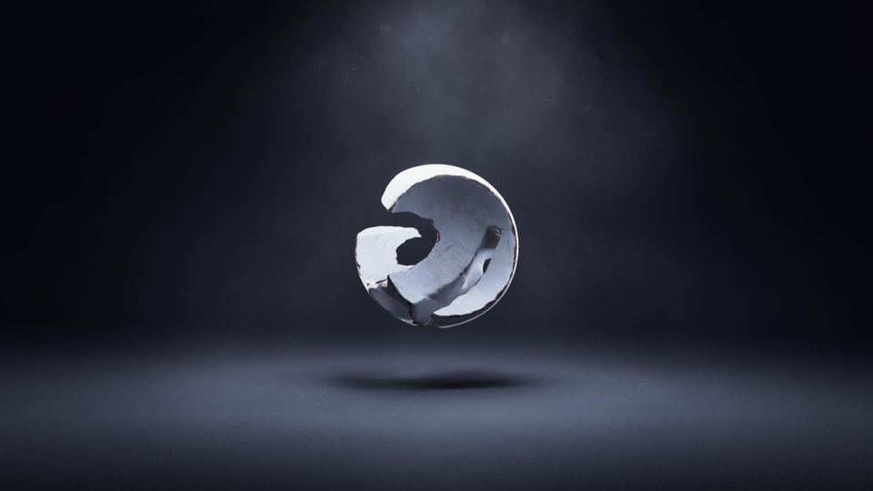
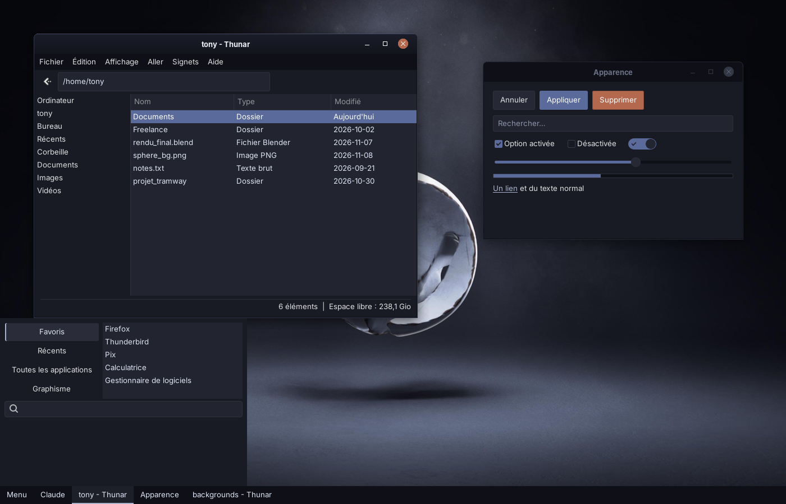
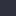
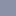
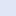
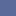
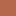

# Sphere Dark

*[English version](README.md)*

Un thème sombre bleu-ardoise et posé, tiré d'un seul fond d'écran éclairé en studio, et appliqué de façon cohérente au bureau et aux outils de création autour : Linux Mint XFCE, le terminal, l'écran de connexion, Blender, Krita, Unreal Engine, Ardour, Firefox et YouTube.





## Principes

- **Trois niveaux de surface.** Le chrome (barres de titre, panel, menus) est le plus foncé, la base (fenêtres, barres latérales, barres d'état) est au milieu, le contenu (listes de fichiers, champs) est le plus clair. Des filets fins les séparent.
- **La lumière vient du haut.** Les barres de titre actives ont un léger dégradé et un liseré lumineux de 1 px, comme le faisceau du fond d'écran. Les fenêtres inactives sont plates et atténuées.
- **Un accent calme.** Bleu-ardoise `#5a6a9a` pour la sélection et les contrôles actifs ; bleu pâle `#a9b4d0` (l'intérieur de la sphère) pour les liens, le focus et les soulignés.
- **Un accent chaud, rare.** Rouille `#b4694f` (l'arête de la sphère), seulement pour les actions destructives, le survol du bouton fermer et les alertes.
- **La fonction d'abord.** Les couleurs qui ont un sens dans une application (axes de Blender, orange de sélection, VU-mètres, boutons d'enregistrement) ne sont pas touchées.

## Palette

La liste complète est dans [`palette.json`](palette.json).

| Rôle | Couleur | |
|---|---|---|
| Chrome (barres de titre, panel) | `#0f1017` |  |
| Fond des fenêtres | `#191b24` |  |
| Surfaces (champs, listes, menus) | `#22242f` |  |
| Relief / bordures | `#2f313e` |  |
| Texte atténué | `#8b92a8` |  |
| Texte principal | `#dfe5f5` |  |
| Accent | `#5a6a9a` |  |
| Accent clair | `#a9b4d0` |  |
| Accent rouille | `#b4694f` |  |

Le texte principal est à 13,6:1 sur le fond des fenêtres ; le blanc sur l'accent est à 5,3:1.

## Composants

| Dossier | Application | Fichier à installer |
|---|---|---|
| [`desktop/`](desktop) | XFCE : GTK 2/3/4, libadwaita, xfwm4, panel, menu Whisker, Thunar | `desktop/Sphere-Dark/` |
| [`terminal/`](terminal) | xfce4-terminal | `sphere-dark.theme` |
| [`login/`](login) | Écran de connexion (slick-greeter / LightDM) | `install-login-assets.sh` |
| [`blender/`](blender) | Blender 5.2+ | extension (zip) |
| [`krita/`](krita) | Krita 5.2 / 5.3 | `Sphere Dark.colors` |
| [`unreal/`](unreal) | Unreal Engine 5 | `SphereDark.json` |
| [`ardour/`](ardour) | Ardour 9 | `sphere_dark-ardour.colors` |
| [`firefox/`](firefox) | Firefox | extension de thème |
| [`youtube/`](youtube) | YouTube (Stylus) | `sphere-dark-youtube.user.css` |

`./build-all.sh` reconstruit tout dans `dist/` (voir [Construire](#construire)).

## Installation

### Bureau (Linux Mint XFCE)

```sh
mkdir -p ~/.themes
cp -r desktop/Sphere-Dark ~/.themes/
```

Choisis **Sphere-Dark** dans *Paramètres → Apparence* (style) et *Paramètres → Gestionnaire de fenêtres* (bordures). Dans les préférences du panel, mets l'arrière-plan sur *Aucun (utiliser le style du système)*.

Icônes : le thème est pensé pour **Papirus-Dark** avec des dossiers bleu-gris (`papirus-folders -C bluegrey --theme Papirus-Dark`). Autres packs qui vont bien : Colloid (variante Nord), Nordzy (sombre), Kora (pgrey). Voir la [planche comparative](docs/screenshots/icon-packs.png).

### Terminal

```sh
cd terminal && ./install.sh
```

Puis *Préférences → Couleurs → Préréglages → Sphere Dark*. Le script ajoute aussi une marge intérieure aux terminaux VTE dans `~/.config/gtk-3.0/gtk.css`.

### Écran de connexion

L'écran de connexion tourne sous un autre utilisateur et ne voit que les dossiers système. Il faut donc y copier le thème et les icônes :

```sh
sudo login/install-login-assets.sh            # Sphere-Dark + icônes Nordzy*
sudo login/install-login-assets.sh 'Papirus*' # autre thème d'icônes
```

Ouvre ensuite *Fenêtre de connexion* et choisis le thème, les icônes et le fond. Relance le script après chaque modification du thème.

### Blender 5.2+

Construis ou télécharge `sphere_dark-blender-1.0.0.zip`, puis *Edit → Preferences → Get Extensions → ⌄ → Install from Disk…*, et choisis **Sphere Dark** dans *Themes*. Le viewport 3D a un dégradé radial de studio ; passe *Background Type* à *Single Color* pour un fond uni.

### Krita

```sh
mkdir -p ~/.local/share/krita/color-schemes
cp "krita/Sphere Dark.colors" ~/.local/share/krita/color-schemes/
```

Pour la version Flatpak, utilise `~/.var/app/org.kde.krita/data/krita/color-schemes/`. Redémarre Krita et choisis *Configuration → Thèmes → Sphere Dark*. Mets la bordure du canevas à `#12141b` dans *Configurer Krita → Affichage*.

### Unreal Engine 5

Copie `unreal/SphereDark.json` dans `Engine/Content/Slate/Themes/` de ton installation (crée `Themes` au besoin), puis *Editor Preferences → General → Appearance → Active Theme*. Le fond des graphes se règle à part ; valeurs suggérées : fond `#12141b`, grille `#1c1e29` / `#2f313e`.

### Ardour 9

```sh
mkdir -p ~/.config/ardour9/themes
cp ardour/sphere_dark-ardour.colors ~/.config/ardour9/themes/
```

Puis *Preferences → Appearance → Colors → Color Theme → Sphere Dark*.

### Firefox

La version standard de Firefox n'installe que des extensions signées.
- **Pour essayer :** `about:debugging` → *Ce Firefox* → *Charger un module complémentaire temporaire…* → choisis `firefox/manifest.json` (retiré au redémarrage).
- **Pour le garder :** envoie `sphere-dark-firefox.zip` sur addons.mozilla.org/developers avec la distribution *Sur votre propre site* ; Mozilla le signe et tu installes le `.xpi` signé.

Astuce : coche *Barre de titre* dans *Personnaliser la barre d'outils* pour que Firefox utilise la barre de titre xfwm4 du thème.

### YouTube

Installe l'extension **Stylus**, crée un nouveau style, colle `youtube/sphere-dark-youtube.user.css`, et mets YouTube en apparence sombre. Pour les autres sites, Dark Reader avec un fond `#191b24`, un texte `#dfe5f5` et une sélection `#5a6a9a` s'en approche.

## Construire

Prérequis : Python 3 avec Pillow, `pysassc` (`pip install libsass`) ou `sassc`, `git`, `zip`.

```sh
./build-all.sh
```

Chaque `build.py` part du thème d'origine de son application (dans `*/source/`, ou Mint-Y récupéré sur GitHub pour le bureau) et le ramène à la palette. Pour retoucher une couleur, modifie la palette en haut du `build.py` concerné et relance.

## État

| Composant | Vérification |
|---|---|
| Bureau (GTK 3) | CSS compilé et rendu avec de vrais widgets GTK 3 ; utilisé au quotidien par l'auteur |
| Écran de connexion | Script testé sur une fausse racine ; widgets rendus avec GTK 3 |
| Blender | Chargé dans Blender 5.2.3 (bpy) avec le chargeur de préréglages de Blender ; extension validée |
| Firefox | Validé avec `web-ext lint` |
| Unreal Engine | Les clés correspondent aux 61 entrées `EStyleColor` (doc UE 5.8) |
| Ardour | Palette seulement ; les 429 alias et 41 modificateurs sont identiques à l'original |
| Krita, terminal, YouTube | Format vérifié ; aperçus dessinés à partir de la palette |

Les captures des vraies applications sont les bienvenues.

## Crédits

- Thème de bureau construit sur **Mint-Y** de Linux Mint ([linuxmint/mint-themes](https://github.com/linuxmint/mint-themes), GPL-3.0+).
- Thème Blender dérivé du thème par défaut de Blender ; thème Krita de *Krita darker* ; thème Ardour du thème *dark* d'Ardour.
- Noms de variables YouTube repérés dans le style utilisateur Catppuccin.
- Fond d'écran de l'auteur ; seul un aperçu est inclus.

## Licence

[GPL-3.0-or-later](LICENSE), comme l'exigent les sources de Mint-Y sur lesquelles le thème de bureau est construit.
