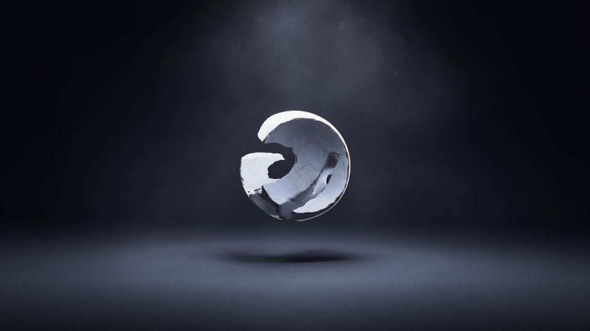
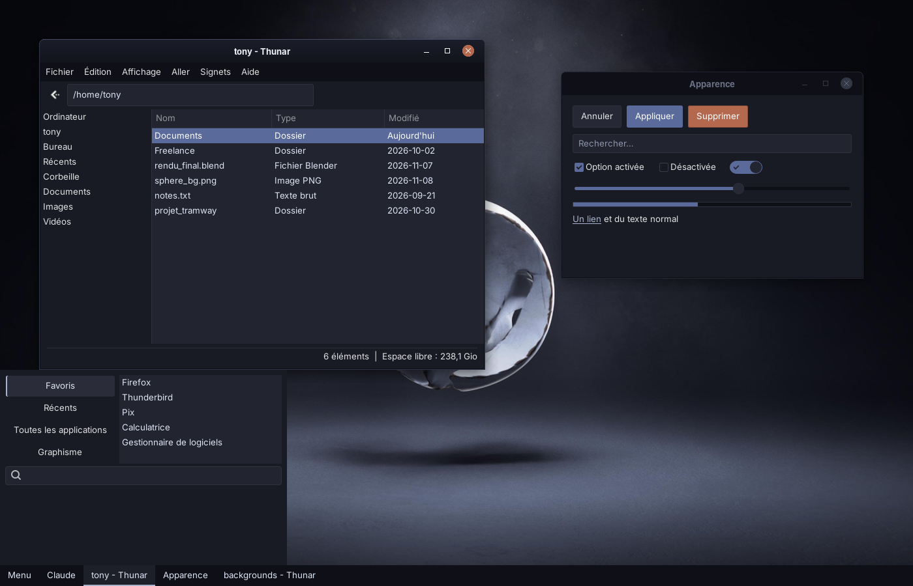
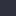
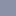
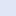
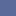
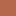

# Sphere Dark

*[Version française](README.fr.md)*

A calm slate-blue dark theme, derived from a single studio-lit wallpaper and applied consistently across the desktop and the creative tools around it: Linux Mint XFCE, the terminal, the login screen, Blender, Krita, Unreal Engine, Ardour, KeePassXC, Git Cola, Firefox and YouTube.





## Design

- **Three surface levels.** Chrome (title bars, panel, menus) is the darkest, the base (windows, sidebars, status bars) sits in the middle, content (file lists, fields) is the lightest. Thin lines separate them.
- **Light from above.** Active title bars have a subtle top-down gradient and a 1 px highlight rim, like the light beam in the wallpaper. Inactive windows are flat and muted.
- **One calm accent.** Deep slate blue `#5a6a9a` for selection and active controls; pale blue `#a9b4d0` (the inside of the sphere) for links, focus rings and underlines.
- **One rare warm accent.** Rust `#b4694f` (the sphere's edge) only for destructive actions, the close-button hover and alerts.
- **Function first.** Colors that carry meaning in an application (Blender axes, selection orange, audio meters, record buttons) are left alone.

## Palette

The full list is in [`palette.json`](palette.json).

| Role | Color | |
|---|---|---|
| Chrome (title bars, panel) | `#0f1017` |  |
| Window background | `#191b24` |  |
| Surfaces (fields, lists, menus) | `#22242f` |  |
| Raised / borders | `#2f313e` |  |
| Muted text | `#8b92a8` |  |
| Primary text | `#dfe5f5` |  |
| Accent | `#5a6a9a` |  |
| Light accent | `#a9b4d0` |  |
| Rust accent | `#b4694f` |  |

Primary text is 13.6:1 on the window background; white on the accent is 5.3:1.

## Components

| Folder | Application | Installable file |
|---|---|---|
| [`desktop/`](desktop) | XFCE: GTK 2/3/4, libadwaita, xfwm4, panel, Whisker menu, Thunar | `desktop/Sphere-Dark/` |
| [`terminal/`](terminal) | xfce4-terminal | `sphere-dark.theme` |
| [`login/`](login) | Login screen (slick-greeter / LightDM) | `install-login-assets.sh` |
| [`blender/`](blender) | Blender 5.2+ | extension (zip) |
| [`krita/`](krita) | Krita 5.2 / 5.3 | `Sphere Dark.colors` |
| [`unreal/`](unreal) | Unreal Engine 5 | `SphereDark.json` |
| [`ardour/`](ardour) | Ardour 9 | `sphere_dark-ardour.colors` |
| [`qt/`](qt) | Qt apps: KeePassXC, Git Cola and most others (qt5ct / qt6ct) | `sphere-dark.conf` |
| [`firefox/`](firefox) | Firefox | [Firefox Add-ons](https://addons.mozilla.org/firefox/addon/sphere-dark/) |
| [`youtube/`](youtube) | YouTube (Stylus) | `sphere-dark-youtube.user.css` |

Run `./build-all.sh` to rebuild everything into `dist/` (see [Building](#building)).

## Installation

### Desktop (Linux Mint XFCE)

```sh
mkdir -p ~/.themes
cp -r desktop/Sphere-Dark ~/.themes/
```

Pick **Sphere-Dark** in *Settings → Appearance* (style) and *Settings → Window Manager* (borders). In the panel preferences, set the background to *None (use system style)*.

### Icons (Nordzy)

The theme is designed around the **Nordzy** icons by alvatip, whose slate-blue Nord palette matches Sphere Dark. They are not bundled here; install them from [the Nordzy repository](https://github.com/alvatip/Nordzy-icon):

```sh
git clone https://github.com/alvatip/Nordzy-icon.git
cd Nordzy-icon
./install.sh -c dark
```

This installs **Nordzy-dark** in `~/.local/share/icons`. Pick it in *Settings → Appearance → Icons*. To use it on the login screen too, run `sudo login/install-login-assets.sh` afterwards (see [Login screen](#login-screen)).

Other packs that fit well: Papirus-Dark with blue-grey folders (`papirus-folders -C bluegrey --theme Papirus-Dark`), Colloid (Nord variant), Kora (pgrey). See the [comparison sheet](docs/screenshots/icon-packs.png).

### Terminal

```sh
cd terminal && ./install.sh
```

Then *Preferences → Colors → Presets → Sphere Dark*. The script also adds inner padding to VTE terminals in `~/.config/gtk-3.0/gtk.css`.

### Login screen

The login screen runs as another user and only sees system folders, so the theme and icons must be copied there:

```sh
sudo login/install-login-assets.sh            # Sphere-Dark + Nordzy* icons
sudo login/install-login-assets.sh 'Papirus*' # another icon theme
```

Then open *Login Window* and choose the theme, icons and background. Run the script again after changing the theme.

### Qt apps (KeePassXC, Git Cola)

KeePassXC and Git Cola follow the system Qt palette. Install qt5ct and qt6ct, then run the script (without sudo):

```sh
sudo apt install qt5ct qt6ct
qt/install-qt.sh
```

It installs the palette for Qt 5 and Qt 6, sets the Fusion style and your current icon theme, adds `QT_QPA_PLATFORMTHEME=qt5ct` to `~/.profile` (qt6ct also answers to `qt5ct`), and sets Git Cola's diff colors with `git config --global cola.*`. Log out and back in, then choose *Settings → Interface → Theme → Classic* in KeePassXC. Keep Git Cola on its *Default* theme: a custom `.qss` theme makes Git Cola switch to a light palette on a dark system.


### Blender 5.2+

Build or download `sphere_dark-blender-1.0.0.zip`, then *Edit → Preferences → Get Extensions → ⌄ → Install from Disk…* and pick **Sphere Dark** under *Themes*. The 3D viewport uses a radial studio gradient; switch *Background Type* to *Single Color* if you prefer a flat one.

### Krita

```sh
mkdir -p ~/.local/share/krita/color-schemes
cp "krita/Sphere Dark.colors" ~/.local/share/krita/color-schemes/
```

For the Flatpak version, use `~/.var/app/org.kde.krita/data/krita/color-schemes/`. Restart Krita and choose *Settings → Themes → Sphere Dark*. Set the canvas border to `#12141b` in *Configure Krita → Display*.

### Unreal Engine 5

Copy `unreal/SphereDark.json` to `Engine/Content/Slate/Themes/` in your engine folder (create `Themes` if needed), then *Editor Preferences → General → Appearance → Active Theme*. Graph backgrounds are set separately; suggested values: background `#12141b`, grid `#1c1e29` / `#2f313e`.

### Ardour 9

```sh
mkdir -p ~/.config/ardour9/themes
cp ardour/sphere_dark-ardour.colors ~/.config/ardour9/themes/
```

Then *Preferences → Appearance → Colors → Color Theme → Sphere Dark*.

### Firefox

Sphere Dark is published on Firefox Add-ons: **[install it from addons.mozilla.org](https://addons.mozilla.org/firefox/addon/sphere-dark/)**. It updates automatically like any other theme.

To test changes to `firefox/manifest.json` before publishing them, load it from `about:debugging` → *This Firefox* → *Load Temporary Add-on…* (removed on restart).

Tip: enable *Title Bar* in *Customize Toolbar* so Firefox uses the themed xfwm4 title bar.

### YouTube

Install the **Stylus** extension, create a new style, paste `youtube/sphere-dark-youtube.user.css`, and set YouTube to its dark appearance. For other sites, Dark Reader with background `#191b24`, text `#dfe5f5` and selection `#5a6a9a` gets close.

## Building

Requirements: Python 3 with Pillow, `pysassc` (`pip install libsass`) or `sassc`, `git`, `zip`.

```sh
./build-all.sh
```

Each `build.py` takes the original theme of its application (in `*/source/`, or Mint-Y fetched from GitHub for the desktop) and maps it to the palette. To retune a color, edit the palette at the top of the relevant `build.py` and rebuild.

## Status

| Component | How it was checked |
|---|---|
| Desktop (GTK 3) | CSS compiled and rendered with real GTK 3 widgets; in daily use on the author's machine |
| Login screen | Script tested on a mock file system; widgets rendered with GTK 3 |
| Blender | Loaded into Blender 5.2.3 (bpy) with Blender's own preset loader; extension validated |
| Firefox | Validated with `web-ext lint`; signed and published on addons.mozilla.org |
| Unreal Engine | Keys match the 61 `EStyleColor` entries (UE 5.8 docs) |
| Ardour | Palette only; all 429 aliases and 41 modifiers identical to the original |
| Qt apps | Palette rendered with Qt 6 Fusion; install script tested with a mock home folder |
| Krita, terminal, YouTube | Format checked; previews drawn from the palette |

Screenshots of the real applications are welcome.

## Credits

- Desktop theme built on **Mint-Y** by Linux Mint ([linuxmint/mint-themes](https://github.com/linuxmint/mint-themes), GPL-3.0+).
- Blender theme derived from Blender's default theme; Krita theme from *Krita darker*; Ardour theme from Ardour's *dark* theme.
- YouTube variable names researched from the Catppuccin userstyle.
- Recommended icons: [Nordzy](https://github.com/alvatip/Nordzy-icon) by alvatip (GPL-3.0), installed separately.
- Wallpaper by the author; only a preview is included.

## License

[GPL-3.0-or-later](LICENSE), as required by the Mint-Y sources the desktop theme is built on.
